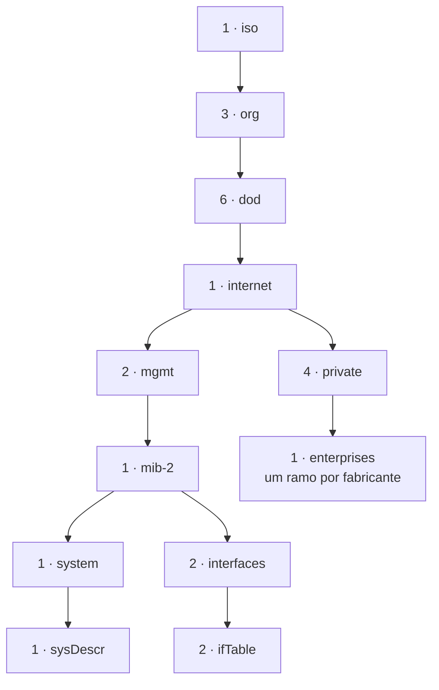

# Atividade 7: SNMP, perguntar números a uma máquina

- Prazo: sexta-feira, 16/10/2026, às 20h
- Unidade: 2
- Onde: no seu laboratório
- Acompanhamento: `/atividades atividade:7` no Discord
- Nota: proporcional aos itens cumpridos. 5 itens valem 10.

Nas atividades anteriores você mediu o servidor a partir de fora, pela rede. O monitor da atividade 5 perguntava ao front por HTTP, e o Uptime Kuma fazia o mesmo com uma tela melhor. Os dois dizem se o serviço respondeu, e nada além disso.

Agora você vai buscar métricas de dentro do servidor ou do equipamento de rede. Quantos bytes passaram por cada interface, quanto de disco sobrou, há quanto tempo a máquina está ligada: nenhum desses números sai de um GET.

É para isso que existe SNMP.

## O que é SNMP

SNMP é o protocolo que um sistema de gerência usa para ler e escrever valores mantidos por um equipamento. Nesta atividade você só lê, que é o uso mais comum e o único que a configuração do agente da disciplina permite.

A conversa tem dois lados. O **agente** roda na máquina observada e mantém os valores: bytes que passaram em cada interface, memória livre, processos em execução, tempo desde o último reinício. Ele responde quando perguntam e não envia nada por conta própria. O **gerente** é quem pergunta, e pode ser um comando de uma linha, como você vai usar hoje, ou um sistema que consulta trezentos equipamentos de minuto em minuto e desenha gráficos.

As perguntas vão por UDP, na porta 161. Sem conexão estabelecida, uma pergunta perdida no caminho não gera erro em lado nenhum, e cabe ao gerente repetir depois do tempo de espera. O `snmpget` faz isso sozinho, com cinco segundos de espera e uma repetição.

### Objetos, OIDs e a MIB

O agente não guarda um texto livre, e sim um conjunto de **objetos** definidos em documentos chamados MIB. Cada MIB especifica, para cada objeto, o nome, o tipo do valor, se ele é de leitura ou de escrita e o que ele significa. A MIB-2, publicada na RFC 1213, define os objetos que todo equipamento precisa ter, como a descrição do sistema e a tabela de interfaces.

Cada objeto recebe um identificador numérico, o **OID**, que é um caminho numa árvore:

```
1.3.6.1.2.1.1.1.0
```



Esse caminho vale igual em qualquer equipamento. Um fabricante não pode mudar a descrição do sistema de lugar, e é essa estabilidade que permite a um gerente falar com equipamento de dez marcas diferentes. O que cada fabricante acrescenta de próprio fica abaixo do ramo `enterprises`.

Decorar números seria impraticável, e os arquivos de MIB instalados no seu laboratório fazem a tradução. Com eles, o mesmo objeto se escreve pelo nome:

```
SNMPv2-MIB::sysDescr.0
```

### Objeto e instância

O OID do objeto termina em `1`, e a consulta acima termina em `1.0`. Esse último número é a **instância**.

Objetos que existem em cópia única, como a descrição do sistema, têm uma instância só, identificada por `.0`. Objetos que existem em várias cópias, como os bytes que entraram numa interface, têm uma instância por linha da tabela, identificada pelo índice: `ifInOctets.2` é o contador da interface de índice 2.

Pedir `sysDescr` sem o `.0` devolve erro, porque você estaria pedindo o objeto, e o que trafega é sempre uma instância.

### O tipo do valor muda a leitura

A resposta do agente vem com o tipo, e ele diz como interpretar o número:

`STRING` é texto livre, como a descrição do sistema.

`INTEGER` é um número com significado próprio, às vezes com rótulo: a MIB-2 define `ifOperStatus` com `1` para `up` e `2` para `down`.

`Gauge32` é uma medida instantânea, que sobe e desce, como o número de processos.

`Counter32` só cresce e volta a zero quando estoura. Os bytes de uma interface são contador, e é por isso que o passo 5 existe.

`Timeticks` conta centésimos de segundo desde que o agente subiu.

### As três versões

A **v1**, de 1988, ainda aparece em equipamento antigo.

A **v2c** é a mais usada. A autenticação é uma palavra chamada *community*, enviada em texto puro dentro do pacote, e qualquer um que capture o tráfego a lê. O passo 6 mostra isso acontecendo.

A **v3** acrescenta usuário, autenticação por senha e cifra do conteúdo. É o que se usa quando a consulta atravessa uma rede que você não controla.

## O que você vai fazer

Primeiro você é o gerente, consultando o agente da disciplina. Depois você é o agente, respondendo às perguntas que o servidor faz ao seu laboratório.

O agente da disciplina é uma máquina de brinquedo chamada `roteador-escola`, no endereço `172.30.0.161`, alcançável de dentro do seu laboratório. A community de leitura é `redes2026`.

## Passo 1: entre no laboratório

```
ssh -i ~/.ssh/gr-lab -p SUAPORTA aluno@gr.lab.ayty.org
```

O `snmpget`, o `snmpwalk` e o `snmptable` já estão instalados, com as MIBs.

## Passo 2: a primeira pergunta

```
snmpget -v2c -c redes2026 172.30.0.161 SNMPv2-MIB::sysDescr.0
```

Lendo o comando: `-v2c` escolhe a versão, `-c redes2026` passa a community, e em seguida vêm o endereço do agente e a instância que você quer ler.

A resposta sai assim:

```
SNMPv2-MIB::sysDescr.0 = STRING: Linux roteador-escola 6.8.0-137-generic ...
```

**Escreva essa resposta** em `~/snmp.txt`, só o texto depois de `STRING: `:

```
item1=Linux roteador-escola 6.8.0-137-generic ...
```

Se quiser só o valor, sem o nome do OID na frente, acrescente `-Oqv` ao comando.

## Passo 3: caminhar na árvore

O `snmpget` pede um valor. O `snmpwalk` pede todos os valores abaixo de um ponto:

```
snmpwalk -v2c -c redes2026 172.30.0.161 SNMPv2-MIB::system
```

Saem o nome, a localização, o contato e o tempo desde o último reinício. Diante de um equipamento desconhecido, caminhar pela árvore é como se descobre quais objetos ele implementa.

## Passo 4: a tabela de interfaces

Os objetos com uma instância por interface ficam numa tabela, e o `snmptable` a monta em colunas:

```
snmptable -v2c -c redes2026 -Cb 172.30.0.161 IF-MIB::ifTable
```

```
 Index Descr             Type   Mtu  Speed AdminStatus OperStatus  InOctets OutOctets
     1    lo softwareLoopback 65536 10000000        up         up         0         0
     2  eth0   ethernetCsmacd  1500 ...             up         up      2768      3110
```

Cada linha é uma interface, identificada pelo índice da primeira coluna. Esse índice é o que aparece no fim do OID quando você pede um valor dessa linha, como em `ifInOctets.2`. As colunas `InOctets` e `OutOctets` trazem os bytes que entraram e saíram desde o último reinício.

**Escreva o nome da interface de índice 2** em `~/snmp.txt`:

```
item2=...
```

## Passo 5: de contador para taxa

O `InOctets` é um `Counter32`, e contador só cresce. O agente não oferece a velocidade em bits por segundo em lugar nenhum da MIB-2. Quem calcula é o gerente, com duas leituras e a diferença entre elas:

```
A=$(snmpget -v2c -c redes2026 -Oqv 172.30.0.161 IF-MIB::ifInOctets.2)
sleep 10
B=$(snmpget -v2c -c redes2026 -Oqv 172.30.0.161 IF-MIB::ifInOctets.2)
echo "$(( (B - A) / 10 )) bytes por segundo"
```

Todo gráfico de banda é feito assim, repetindo essa conta a cada intervalo de coleta.

Duas situações quebram essa conta. O contador de 32 bits estoura e volta a zero, o que numa interface de 1 Gbit/s saturada acontece em cerca de 34 segundos, e por isso a MIB define o `ifHCInOctets`, de 64 bits. E quando o equipamento reinicia entre as duas leituras, o contador recomeça do zero e a subtração fica negativa, caso que o coletor precisa descartar.

## Passo 6: a community em texto puro

O servidor da disciplina pergunta ao seu laboratório de dois em dois minutos, com uma community que é só sua. Ela viaja em texto puro dentro do pacote. Capture e leia:

```
sudo tcpdump -i any -n -A udp port 161
```

Espere a próxima pergunta chegar. No meio dos caracteres ilegíveis do pacote aparece uma palavra começando com `GR7-`.

**Escreva essa palavra** em `~/snmp.txt`:

```
item3=GR7-...
```

A palavra aparece mesmo com o seu agente desligado, porque o pacote chega à interface de qualquer maneira e a captura acontece antes de qualquer processamento. Essa é a limitação do v2c que motivou a v3, e a razão de ninguém expor SNMP v2c à internet.

## Passo 7: agora você é o agente

Edite o `/etc/snmp/snmpd.conf` do seu laboratório e deixe só estas linhas:

```
agentaddress udp:161
rocommunity turma 172.30.0.0/16
rocommunity turma 127.0.0.1
sysLocation SEU-SLUG
```

Troque `SEU-SLUG` pelo seu identificador, aquele que aparece no nome do seu laboratório: se o seu e-mail é `joao.silva@dcx.ufpb.br`, o slug é `joao-silva`.

Lendo as linhas: `agentaddress` define em que porta o agente escuta, `rocommunity` cria uma community de leitura válida apenas para quem vem da rede indicada, e `sysLocation` preenche um objeto da MIB-2 com um texto livre.

Suba o agente:

```
sudo snmpd -Lf /dev/null
```

Se você ligou o firewall no CTF, ele está bloqueando a porta 161, e o servidor não vai conseguir perguntar. Libere só para a rede dos laboratórios:

```
sudo ufw allow from 172.30.0.0/16 to any port 161 proto udp
```

Confira com `sudo ufw status`: a linha precisa aparecer como `161/udp ALLOW 172.30.0.0/16`.

E pergunte a ele mesmo, de dentro do laboratório:

```
snmpget -v2c -c turma -Oqv 127.0.0.1 SNMPv2-MIB::sysLocation.0
```

Precisa responder o seu slug. A partir daí o servidor pergunta de fora, e o item fecha sozinho.

## Passo 8: a mesma pergunta, agora cifrada

Pare o agente:

```
sudo pkill snmpd
```

Crie o usuário de v3:

```
sudo net-snmp-create-v3-user -ro -A redes2026snmp -a SHA-512 -X redes2026snmp -x AES aluno
```

Lendo: `-ro` é só leitura, `-a SHA-512` com `-A` é a senha de autenticação, `-x AES` com `-X` é a senha de cifra, e `aluno` é o nome do usuário. O comando escreve a configuração sozinho.

Suba o agente de novo e pergunte em v3:

```
sudo snmpd -Lf /dev/null
snmpget -v3 -l authPriv -u aluno -a SHA-512 -A redes2026snmp -x AES -X redes2026snmp \
  127.0.0.1 SNMPv2-MIB::sysLocation.0
```

O `-l authPriv` pede autenticação e cifra. A v3 define outros dois níveis: `noAuthNoPriv`, sem nenhuma das duas, e `authNoPriv`, que autentica o usuário e deixa o conteúdo legível na rede.

**Capture essa consulta** como você fez no passo 6 e compare com a anterior. Na v2c você leu a community e o valor devolvido. Na v3 com `authPriv`, o nome do usuário também viaja cifrado.

## Os 5 itens

1. A descrição do agente da disciplina, em `item1`.
2. O nome da interface de índice 2, em `item2`.
3. A community que o gerente usa com você, em `item3`.
4. O seu agente respondendo em v2c, com a community `turma` e `sysLocation` igual ao seu slug.
5. O mesmo agente respondendo em v3, com o usuário `aluno`.

Os três primeiros você escreve em `~/snmp.txt`, uma linha cada. Os dois últimos eu verifico perguntando ao seu laboratório.

Confira o que já conta com `/atividades atividade:7`.

## Quando algo não funciona

- `Timeout: No Response`: o agente não está no ar, ou a community está errada, ou o endereço. Confira com `ss -lnup | grep 161` dentro do laboratório.
- O agente responde de dentro do laboratório e o bot continua dizendo que não responde: é o firewall. Veja `sudo ufw status` e libere a 161/udp para `172.30.0.0/16`.
- Os nomes aparecem como `iso.3.6.1.2.1...`: falta MIB. No seu laboratório elas já estão instaladas; se sumirem, o pacote é o `snmp-mibs-downloader`, e a linha `mibs :` do `/etc/snmp/snmp.conf` precisa estar comentada.
- `snmptable` responde "Was that a table?": é o mesmo problema de MIB.
- O `tcpdump` não mostra nada na 161: a pergunta do servidor chega de dois em dois minutos, então espere. E capture em `-i any`.
- Outras dúvidas: `/ajuda problema texto: ...` no Discord.
