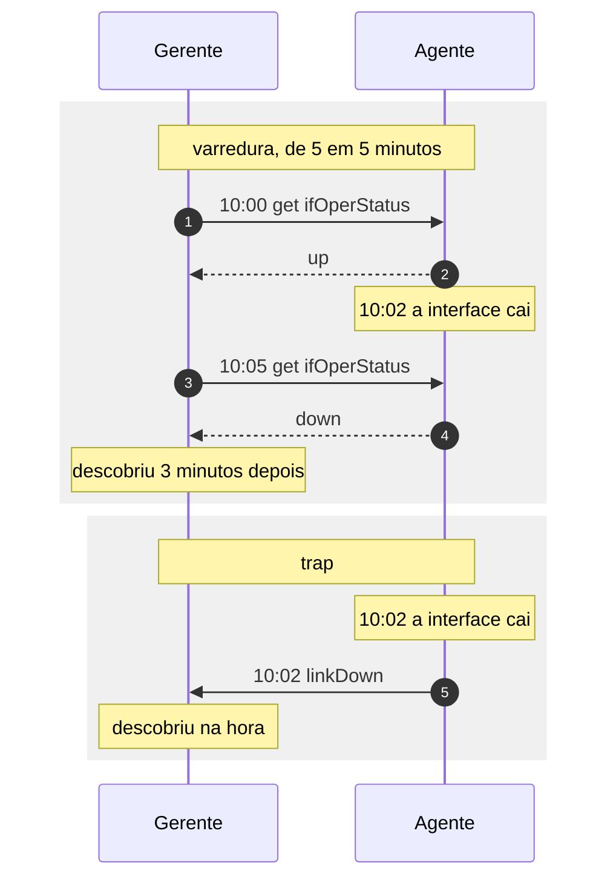

# Atividade 8: quando o agente avisa

- Prazo: quinta-feira, 22/10/2026, às 20h
- Unidade: 2
- Onde: no seu laboratório
- Acompanhamento: `/atividades atividade:8` no Discord
- Nota: proporcional aos itens cumpridos. 4 itens valem 10.

Na atividade 7 o gerente iniciava toda a conversa. O agente respondia o que era perguntado e não tinha como avisar nada por conta própria.

O intervalo entre as perguntas vira atraso na descoberta. Com varredura de cinco em cinco minutos, uma interface que cai logo depois da pergunta fica cinco minutos caída sem ninguém saber. Perguntar de dez em dez segundos reduz esse atraso e multiplica o tráfego e a carga nos equipamentos.

O trap inverte a direção. O agente manda o aviso no momento do evento, sem esperar pergunta.



Os dois desenhos descrevem a mesma queda. O que muda é quem fala primeiro, e o atraso entre o evento e a descoberta.

## O que é um trap

Trap é o nome que a v1 deu à **notificação**: uma mensagem que o agente envia ao gerente sem ter sido perguntado. A v2c manteve o nome e acrescentou o `inform`, que é a mesma notificação com confirmação de recebimento.

A notificação vai por UDP para a porta 162, vizinha da 161 que você usou na atividade 7. As duas portas pertencem a papéis diferentes: na 161 o agente escuta perguntas, e na 162 quem escuta é o receptor de notificações, que costuma ficar na máquina do gerente.

O agente não descobre sozinho para onde mandar. O endereço do receptor fica na configuração dele, e é isso que você faz no passo 2.

### O que viaja numa notificação

Toda notificação de v2c carrega dois objetos obrigatórios, nesta ordem:

`sysUpTime.0`, o tempo desde que o agente subiu, que situa o evento no tempo da máquina que avisou.

`snmpTrapOID.0`, o OID que identifica o tipo do aviso. As notificações padrão vêm definidas em MIB, como `coldStart` para o reinício e `linkDown` e `linkUp` para a mudança de estado de uma interface.

Depois desses dois vêm os pares de OID e valor acrescentados pelo agente, chamados *varbinds*. Quem envia escolhe quais são, e é por aí que o aviso carrega a medida que motivou o alerta.

Você vai ver esses três elementos no registro do receptor e na sua própria captura.

### O que o trap não garante

O trap não tem resposta. O agente envia e segue adiante, então um pacote perdido no caminho não é percebido por nenhum dos dois lados. O `inform` existe para esse caso: o receptor confirma, e o agente repete enquanto não receber a confirmação, ao custo de guardar estado e de um pacote a mais por aviso.

Há um segundo risco, do lado oposto. Uma interface que oscila gera uma notificação a cada mudança, e um equipamento com problema intermitente pode enterrar o receptor em avisos. Por isso o monitoramento de produção usa os dois mecanismos: a varredura mantém o retrato do estado, e as notificações antecipam os eventos entre uma varredura e outra.

### O receptor desta atividade

O receptor é o mesmo `roteador-escola`, em `172.30.0.161`. Nele roda um `snmptrapd` escutando a porta 162, configurado para registrar o que chega com a community `alertas`. Notificação que chegar com outra community é descartada sem registro.

## Passo 1: mandar um trap à mão

Entre no seu laboratório e mande o primeiro aviso, trocando `SEU-SLUG` pelo seu identificador:

```
snmptrap -v2c -c alertas 172.30.0.161 "" 1.3.6.1.4.1.8072.2.3.0.1 \
  SNMPv2-MIB::sysLocation.0 s "GR8-SEU-SLUG"
```

Lendo o comando por partes:

`-v2c -c alertas` é a versão e a community do receptor, igual ao que você usou no `snmpget`.

`172.30.0.161` é para onde o aviso vai.

As aspas vazias são o `sysUpTime.0`. Com elas vazias, o `snmptrap` preenche o valor com o tempo da própria máquina.

`1.3.6.1.4.1.8072.2.3.0.1` é o valor de `snmpTrapOID.0`, o tipo do aviso. Esse OID vem da MIB de exemplos do net-snmp e serve para testar sem precisar registrar um número próprio no ramo `enterprises`.

O resto é o varbind que viaja junto, em três partes: o OID `sysLocation.0`, o tipo `s` de texto e o valor.

O comando não imprime nada quando dá certo, porque não existe resposta para esperar. Confira pelo `/atividades atividade:8`.

## Passo 2: o agente avisando sozinho

O comando do passo 1 mostra o caminho funcionando. O agente também avisa por conta própria quando algo acontece com ele, e é isso que você configura agora.

Acrescente uma linha ao `/etc/snmp/snmpd.conf`:

```
trap2sink 172.30.0.161 alertas
```

A linha tem o endereço do receptor e a community que ele aceita. Reinicie o agente:

```
sudo pkill snmpd
sudo snmpd -Lf /dev/null
```

Ao subir, o agente manda sozinho um `coldStart`, o aviso de reinício. Equipamento de rede faz isso de fábrica, e é por esse aviso que um sistema de monitoramento registra que um roteador reiniciou de madrugada, sem ter perguntado nada.

## Passo 3: publicar uma métrica que não existe na MIB

As MIBs trazem o que os autores previram: interfaces, memória, disco, processos. Elas não trazem quantos pedidos a sua aplicação respondeu, nem quantos arquivos ficaram na fila de backup.

A diretiva `extend` liga um comando seu a um OID. O agente executa esse comando a cada consulta, com o usuário dele, e devolve a saída como valor. Comando demorado deixa a consulta demorada, e um comando que trava segura o agente, então o que entra aqui precisa ser rápido e previsível.

Acrescente ao `/etc/snmp/snmpd.conf`:

```
extend processos /bin/sh -c "ps -e --no-headers | wc -l"
```

Reinicie o agente e leia de dentro do laboratório:

```
snmpget -v2c -c turma -Oqv 127.0.0.1 \
  'NET-SNMP-EXTEND-MIB::nsExtendOutputFull."processos"'
```

O nome que você deu, `processos`, faz parte do OID, entre aspas. Para o item contar, ele precisa ser exatamente esse, porque é por ele que eu vou perguntar.

O `extend` publica mais de um objeto para o mesmo nome. O `nsExtendOutputFull` traz a saída inteira, o `nsExtendOutLine` traz uma instância por linha da saída, e o `nsExtendResult` traz o código de saída do comando, que é por onde um gerente descobre que o comando falhou.

As aspas simples em volta do OID inteiro protegem as aspas duplas de dentro, que o shell removeria.

A partir daqui qualquer gerente lê o seu número como lê qualquer outro valor da MIB. O `extend` transforma a saída de um comando local em valor consultável pela rede, e é assim que métrica de aplicação entra num sistema de gerência que só fala SNMP.

## Passo 4: o trap com a medida dentro

Agora os dois juntos. O aviso vai levar o número que o seu agente publica:

```
V=$(snmpget -v2c -c turma -Oqv 127.0.0.1 \
  'NET-SNMP-EXTEND-MIB::nsExtendOutputFull."processos"')
snmptrap -v2c -c alertas 172.30.0.161 "" 1.3.6.1.4.1.8072.2.3.0.1 \
  SNMPv2-MIB::sysLocation.0 s "$V"
```

A primeira linha guarda o valor numa variável, e a segunda manda esse valor dentro do trap.

O alerta que chega com a medida dentro poupa uma ida e volta. Quando o aviso traz só o tipo do evento, o gerente precisa perguntar de volta, e a resposta descreve o estado do momento da pergunta, que já pode ser outro.

## Os 4 itens

1. Um trap seu, mandado à mão, com `GR8-` seguido do seu slug no valor.
2. Um `coldStart` do seu agente, que só chega com o `trap2sink` configurado.
3. A sua métrica publicada em `nsExtendOutputFull."processos"`, com o número batendo com a contagem de processos do seu laboratório.
4. Um trap seu carregando esse número, com folga de 5 para mais ou para menos.

Os traps ficam registrados no servidor com o endereço de origem, e é por ele que eu sei de quem veio cada um. Não existe arquivo para preencher nesta atividade.

Confira o que já conta com `/atividades atividade:8`.

## Quando algo não funciona

- O `snmptrap` não imprime nada: é o comportamento normal dele, porque trap não tem resposta. Confira pelo bot.
- O item 2 não fecha: o `trap2sink` precisa estar no `snmpd.conf` antes de o agente subir. Reinicie e confira com `pgrep -a snmpd`.
- O item 3 diz `No Such Instance`: o agente subiu sem a linha `extend`, ou o nome não é `processos`. Reinicie depois de editar.
- O item 3 diz que o número não bate: o `extend` conta os processos do laboratório inteiro, e a diferença aceita é de 5 para mais ou para menos.
- Nada chega ao servidor: o trap sai do seu laboratório para a porta 162. Se você fechou a saída no firewall durante o CTF, libere com `sudo ufw allow out 162/udp`.
- Outras dúvidas: `/ajuda problema texto: ...` no Discord.
