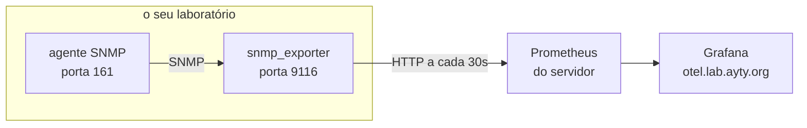

# Atividade 9: o gráfico do seu laboratório

- Prazo: a definir
- Unidade: 2
- Onde: no seu laboratório
- Acompanhamento: `/atividades atividade:9` no Discord
- Nota: proporcional aos itens cumpridos. 4 itens valem 10.

Na atividade 7 você calculou a taxa de uma interface com duas leituras e uma subtração. Agora um coletor faz essa conta a cada 30 segundos, guarda o resultado e desenha o gráfico.

A parte que fica com você é o exportador: o tradutor entre o agente SNMP que você subiu e o Prometheus da disciplina. O Prometheus e o Grafana já estão no ar, e eu cuido deles.

Antes de começar, leia [Prometheus e Grafana: como um gráfico de rede é feito](./PROMETHEUS-E-GRAFANA.md). Ele explica as quatro peças e a consulta que o painel usa.



## O que você precisa ter antes

O agente da atividade 7 no ar, respondendo com a community `turma`:

```
snmpget -v2c -c turma -Oqv 127.0.0.1 SNMPv2-MIB::sysLocation.0
```

Se isso não responder o seu slug, resolva a atividade 7 primeiro.

## Passo 1: instalar o exportador

```
sudo apt-get update && sudo apt-get install -y prometheus-snmp-exporter
```

O Debian entrega o programa sem o arquivo de configuração, por causa da licença das MIBs que ele usa. O próprio pacote avisa isso em `/etc/prometheus/snmp.yml`.

## Passo 2: baixar a configuração

O projeto publica o arquivo pronto, gerado a partir das MIBs. Baixe a versão que combina com o programa do Debian, que é a 0.21:

```
sudo curl -sfL -o /etc/prometheus/snmp.yml \
  https://raw.githubusercontent.com/prometheus/snmp_exporter/v0.21.0/snmp.yml
```

São 1,4 MB e cerca de 65 mil linhas, com dezenas de módulos: um para impressora, um para no-break, um para equipamento da Cisco. Cada módulo é uma lista de OIDs para percorrer e as regras para transformar o resultado em métrica.

Confira que o módulo que interessa está lá:

```
grep -n "^if_mib:" /etc/prometheus/snmp.yml
```

## Passo 3: dizer ao exportador qual é a sua community

O arquivo vem configurado para a community `public`, que não é a sua. Edite o `/etc/prometheus/snmp.yml` e acrescente duas linhas logo abaixo de `if_mib:`, antes do `walk:`:

```
if_mib:
  auth:
    community: turma
  walk:
  - 1.3.6.1.2.1.2
```

A indentação importa: `auth:` com dois espaços, `community:` com quatro.

Sem isso o exportador pergunta com `public`, o seu agente não responde, e a coleta falha por tempo esgotado.

## Passo 4: subir o exportador

```
sudo nohup prometheus-snmp-exporter --config.file=/etc/prometheus/snmp.yml \
  > /var/log/snmp-exporter.log 2>&1 &
```

Confira que ele está escutando:

```
ss -lnt | grep 9116
```

E peça a ele as métricas do seu próprio agente:

```
curl -s "http://127.0.0.1:9116/snmp?target=127.0.0.1&module=if_mib" | grep ifHCInOctets
```

A resposta é um bloco de texto como este, que é o formato que o Prometheus entende:

```
ifHCInOctets{ifAlias="",ifDescr="eth0",ifIndex="2",ifName="eth0"} 4.020229644e+09
```

O `target=127.0.0.1` é o endereço do agente visto de dentro do seu laboratório. O exportador sempre consulta o alvo que o chamador pedir, e é por isso que ele mesmo não precisa de configuração por equipamento.

## Passo 5: deixar o Prometheus entrar

O Prometheus do servidor busca as suas métricas na porta 9116, e o firewall que você ligou no CTF bloqueia. Libere para a rede dos laboratórios:

```
sudo ufw allow from 172.30.0.0/16 to any port 9116 proto tcp
```

A partir daí a coleta acontece sozinha, de 30 em 30 segundos.

## Passo 6: ver o seu gráfico

Abra `https://otel.lab.ayty.org`, procure o painel **Redes 2026.2: interfaces por SNMP** e escolha o seu nome no seletor **Aluno**, no topo.

Os quatro gráficos são a entrada e a saída por interface, o estado operacional e o tempo que o exportador leva para falar com o agente. A primeira linha aparece alguns minutos depois da coleta começar, porque a taxa precisa de pelo menos duas amostras.

Gere tráfego no laboratório e veja a curva subir:

```
curl -s -o /dev/null https://deb.debian.org/debian/dists/bookworm/Release
```

## Os 4 itens

1. O exportador no ar, respondendo na porta 9116 do seu laboratório.
2. O exportador devolvendo as métricas do seu agente, com a community certa.
3. O Prometheus coletando de você, com `up` igual a 1.
4. A série `ifHCInOctets` com dados seus nos últimos dez minutos.

Não há arquivo para preencher. Tudo é verificado pelo que o Prometheus enxerga do seu laboratório.

Confira o que já conta com `/atividades atividade:9`.

## Quando algo não funciona

- `curl` na 9116 responde `connection refused`: o exportador não subiu. Veja `/var/log/snmp-exporter.log`.
- O log diz `Error parsing config file`: o arquivo baixado é de outra versão. Use o da v0.21.0.
- A resposta vem vazia ou com `snmp_error`: a community no `if_mib` está errada, ou o agente da atividade 7 não está no ar.
- O item 3 não fecha e o resto está certo: é o firewall. Confira com `sudo ufw status` e libere a 9116 para `172.30.0.0/16`.
- O painel aparece vazio: confira se escolheu o seu nome no seletor, e espere dois minutos.
- Outras dúvidas: `/ajuda problema texto: ...` no Discord.
