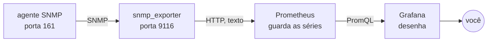

# Prometheus e Grafana: como um gráfico de rede é feito

Nas atividades 7 e 8 você leu valores de um agente SNMP com um comando de cada vez, e calculou a taxa de uma interface com duas leituras e uma subtração. Um sistema de monitoramento faz isso o tempo todo, para muitos equipamentos, e guarda o resultado para você olhar depois. Este texto explica as peças que fazem esse trabalho.

## As quatro peças

**O agente** é quem tem os números, e você já conhece. Ele responde perguntas em SNMP, na porta 161.

**O exportador** traduz. O Prometheus não fala SNMP: ele busca métricas por HTTP, num formato de texto próprio. O `snmp_exporter` recebe um pedido HTTP, consulta o agente por SNMP e devolve o resultado nesse formato.

**O Prometheus** coleta e guarda. De tempos em tempos ele busca as métricas de cada alvo configurado, grava numa base feita para séries temporais e responde consultas sobre esses dados.

**O Grafana** desenha. Ele não guarda métrica nenhuma: pergunta ao Prometheus e mostra o resultado em painéis.



A separação tem um motivo prático. O Prometheus sabe coletar por HTTP e nada mais, e cada tecnologia antiga ganha um exportador próprio: existe um para SNMP, um para PostgreSQL, um para hardware de servidor. Quem escreve o Prometheus não precisa entender SNMP, e quem escreve o exportador não precisa entender armazenamento de série temporal.

## Quem pergunta a quem

O Prometheus busca as métricas, e os alvos não enviam nada por conta própria. Esse modelo se chama *pull*, e é o contrário do trap da atividade 8.

A escolha traz consequências. O Prometheus sabe quando um alvo não respondeu, e registra isso numa métrica chamada `up`, que vale 1 quando a coleta funcionou e 0 quando falhou. Com o modelo oposto, o silêncio de um alvo seria indistinguível de um alvo saudável que não teve nada a dizer.

A configuração dos alvos também fica num lugar só, no Prometheus, em vez de espalhada em cada equipamento.

## O que é uma série temporal

Cada métrica tem um nome e um conjunto de rótulos, e cada combinação é uma série:

```
ifHCInOctets{aluno="joao-silva", ifDescr="eth0", turma="gr"}
```

O nome diz o que é. Os rótulos dizem de quem e de qual interface. O Prometheus guarda, para cada série, uma sequência de pares de instante e valor.

Os rótulos são o que permite perguntar "a entrada de todas as interfaces eth0 da turma" sem ter uma métrica diferente por aluno. É também por rótulo que as séries desta disciplina ficam separadas das de Projeto Avançado, que usam o mesmo Prometheus: as nossas levam `turma="gr"`.

## PromQL, a linguagem das perguntas

O Grafana não inventa os números que mostra: ele envia uma consulta em PromQL ao Prometheus. A consulta do painel de entrada é esta:

```
rate(ifHCInOctets{turma="gr", aluno="$aluno"}[2m]) * 8
```

Lendo por partes: `ifHCInOctets` é a métrica, o que está entre chaves filtra as séries, `[2m]` pega os pontos dos últimos dois minutos, `rate` calcula a variação por segundo nesse intervalo, e o `* 8` converte bytes em bits.

O `rate` é a mesma conta que você fez à mão na atividade 7, com duas leituras e a diferença dividida pelo tempo. Ele também trata o caso do contador que estoura e volta a zero, que você precisou descartar na conta manual.

`$aluno` é uma variável do painel, preenchida pelo seletor no topo da tela.

## O custo de olhar mais de perto

O intervalo de coleta decide o que você enxerga. Com coleta a cada 30 segundos, um pico de 10 segundos pode passar despercebido, e cada ponto a mais multiplica o espaço em disco e o tráfego no equipamento monitorado.

O Prometheus da disciplina coleta de 30 em 30 segundos e guarda 7 dias. Em produção, é comum coletar de 15 em 15 segundos e manter semanas ou meses, com as séries antigas resumidas para ocupar menos.

## O que cada peça não faz

O Prometheus não desenha gráficos, e o que você vê na tela dele é uma ferramenta de depuração da consulta.

O Grafana não guarda dados, e um painel sem o Prometheus atrás não mostra nada.

O exportador não guarda nada: ele consulta o agente no momento em que o Prometheus pede, e esquece.

O agente não tem configuração alguma a respeito do Prometheus. Ele responde SNMP a quem perguntar com a community certa, como respondeu ao seu `snmpget` na atividade 7.
